# [Power System] Power Unit Combination with Strong Yalmip+Cplex - Implementation Based on Mixed-Planning Solving Unit Combination (Yalmip+Cplex Implementation)

Implementation of unit commitment based on mixed-integer programming (using Yalmip + Cplex)
Contents
1. Overview
(1) Optimization Theory of Power Dispatch and Its Application
(2) Unit combination of power dispatching UC
(3) Combinatorial Models and Algorithms
2. Humanized Yalmip+Cplex
(1) Warm-up Exercise - Linear Programming
(2) Unit combination (case study)
3. Yalmip+Cplex for solving unit commitment problems
3.1 Examples
3.2 Objective function
3.3 Constraints
3.4 Model Constraint Handling
3.5 Matlab Code Implementation
Editor
1. Overview (1) The theory of power dispatch optimization and its applications
(2) Unit Combination of Power Dispatching - Editor Uc
(3) Combinatorial Models and Algorithms Editor
Editor
2. Humanized Yalmip+Cplex (1) Warm-up Exercise - Linear Programming
Therefore, Yalmip+Cplex (matlab) has been introduced. The method to download this library in matlab will be discussed later. In the following article, we will discuss the powerful role of Yalmip+Cplex in our power system (Oh man!). Although I enjoy using Python, it was not popularized in recent years. Therefore, the Cplex library is not yet perfect. Hence, I strongly recommend matlab for this library. Let's start with some simple linear programming exercises to warm up everyone.
Editor
% (1) Define decision variables X(1), X(2)
% Result
(2) Unit scheduling (case study):
Editor
[C11, C2 represent cost coefficients, Ql=100sinwt]
Editor
N=3;\nT=24;\nPmax=[100;50;25];\nPmin=[20;40;1];\nC11=diag([.04 .01 .02]);\nC2=[10 20 20];\nPload=100+50*sin((1:T)*2*pi/24);\nI=binvar(N,T,'full');\nP=sdpvar(N,T,'full');\nst=[];\nfor t=1:T\n    st=[st,I(:,t).*Pmin<=P(:,t)<=I(:,t).*Pmax];\nend\nfor t=1:T\n    st=[st,sum(P(:,t))>=Pload(t)];\nend\nfor t=1:T\n    F=0;\n    F=F+P(:,t)'*C11*P(:,t)+C2*P(:,t);\nend\nops=sdpsettings('verbose',0,'solve','cplex');\nr=optimize(st,F);\nF=value(F);\nP=value(P);\nI=value(I);\n  
% Result
Result: Editor
3. Yalmip+Cplex Solution for Unit Scheduling
3.1 Example based on known system data, solve the power situation and unit start/stop status of a 6-machine, 30-node, 41-branch network within a planned time period to minimize the total system cost. The decision variables in this problem are divided into two categories: the first category is the output power of each machine at different times, which are continuous variables; the second category is the start/stop status of each machine at different times, which are integer variables, where 0 represents off and 1 represents on.
This problem belongs to mixed-integer programming (MIP) problems, which require finding an optimal solution in the feasible solution space of the decision variables to achieve the maximum value of the objective function. For mixed-integer programming, CPLEX provides a fast MIP solving method.
3.2 Objective Function Editing
3.3 Constraint Conditions Editing
3.4 Handling Model Constraints
Model constraints contain many conditions that cannot be directly expressed by the program but can only be transformed.
3.5 Matlab Code Implementation
This paper only provides part of the code, all codes can be found here:
%=====Original Quadratic Function Formulation ========\n% For i = 1:gennum\n%     For t = 1:T\n%     totalcost = totalcost + para(i,1)*p(i,t).^2 + para(i,2)*p(i,t) + para(i,3)*u(i,t);  % Coal Consumption Cost\n%     totalcost = totalcost + costH(i,t);                                % Starting Cost\n%     totalcost = totalcost + costJ(i,t);                                % Closing Cost\n%     end\n% end\n%% Load Balancing Constraints\nFor t = 1:T\n    st = st + [sum(p(:,t)) == PL(1,t)]; % Load Balancing Constraint;\nend\n%% Unit Capacity Limitation Constraints\nFor t = 1:T\n    for i = 1:gennum\n        st = st + [u(i,t)*limit(i,2) <= p(i,t) <= u(i,t)*limit(i,1)]; % Unit Capacity Limitation Constraints\n    end\nend\n%% Unit Rate of Change Constraints\n% Derive the following formulas by programming\n% Starting Max Rate of Change\n% Su = (Pmax + Pmin) / 2;\n% Closing Max Rate of Change\n% Sd = (Pmax + Pmin) / 2;\n% Ru = Rud; Rd = Rud;\n%% Uphill Constraints\n% Derive the following formulas by programming\n% For t = 2:T\n% st = st + [p(:,t) - p(:,t-1) <= u(:,t-1).*(Ru-Su) + Su];\n% End\n%% Downhill Constraints\n% Derive the following formulas by programming\n% For t = 2:T\n%st = st + [p(:,t-1) - p(:,t) <= u(:,t).*(Rd-Sd) + Sd];\n% End\n%Expand expressions:\nFor t = 2:T\n    for i = 1:gennum\n        % st = st + [-Rud(i,1)*u(i,t) + (u(i,t)-u(i,t-1))*limit(i,2)-limit(i,1)*(1-u(i,t)) <= p(i,t)-p(i,t-1);\n        % st = st + [p(i,t)-p(i,t-1) <= Rud(i,1)*u(i,t-1)+(u(i,t)-u(i,t-1))*limit(i,2)+limit(i,1)*(1-u(i,t));\n        % Since the original equation may not be able to restart after shutting down, use the following formula instead\n        st = st + [p(i,t-1)-p(i,t) <= Rud(i,1)*u(i,t)+(1-u(i,t))*(limit(i,2)+limit(i,1))/2];% Downhill\n        st = st + [p(i,t)-p(i,t-1) <= Rud(i,1)*u(i,t-1)+(1-u(i,t-1))*(limit(i,2)+limit(i,1))/2];% Uphill\n    end\nend\n%% Thermal Reserve Constraints\nhp = 0.05;% Thermal Reserve Coefficient\nFor t = 1:T\n    st = st + [sum(u(:,t).*limit(:,1)-p(:,t)) >= hp*PL(1,t)];\nend\n%% Startup and Shutdown Time Constraints\n%
Editor
Tried aggregator 2 times.\nMIP Presolve eliminated 3840 rows and 23628 columns.\nMIP Presolve modified 5356 coefficients.\nAggregator did 10 substitutions.\nReduced MIP has 1142 rows, 1130 columns, and 3962 nonzeros.\nReduced MIP has 144 binaries, 0 generals, 0 SOSs, and 0 indicators.\nPresolve time = 0.05 sec. (24.83 ticks)\nProbing time = 0.00 sec. (0.39 ticks)\nTried aggregator 1 time.\nReduced MIP has 1142 rows, 1130 columns, and 3962 nonzeros.\nReduced MIP has 144 binaries, 230 generals, 0 SOSs, and 0 indicators.\nPresolve time = 0.02 sec. (2.70 ticks)\nProbing time = 0.00 sec. (0.37 ticks)\nMIP emphasis: balance optimality and feasibility.\nMIP search method: dynamic search.\nParallel mode: deterministic, using up to 16 threads.\n \nNode log . . .\nBest integer =   1.527930e+07  Node =       0  Best node =   5.968625e+04\nBest integer =   1.080804e+07  Node =       0  Best node =   5.968625e+04\nBest integer =   6.975152e+06  Node =       0  Best node =   4.781375e+06\nBest integer =   6.024695e+06  Node =       0  Best node =   6.024695e+06\nGUB cover cuts applied:  10\nCover cuts applied:  13\nImplied bound cuts applied:  32\nFlow cuts applied:  23\nMixed integer rounding cuts applied:  54\nZero-half cuts applied:  7\nGomory fractional cuts applied:  4\n \nans =\n \n   6.0247e+06\n  
​  

## Images

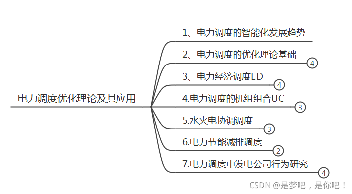
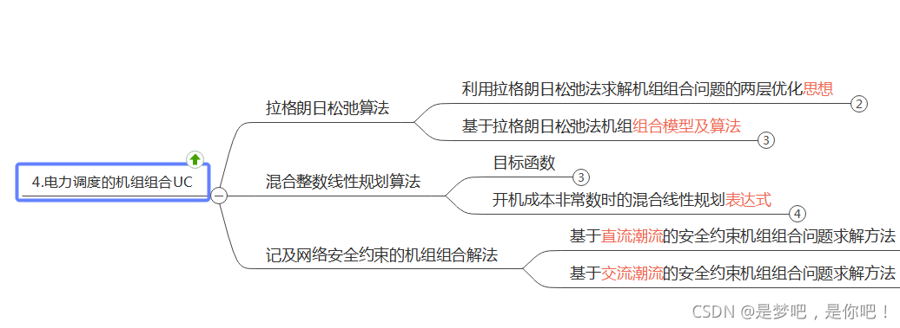
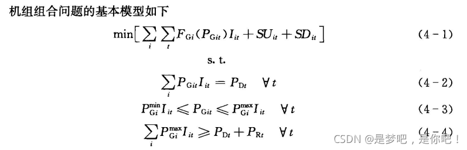
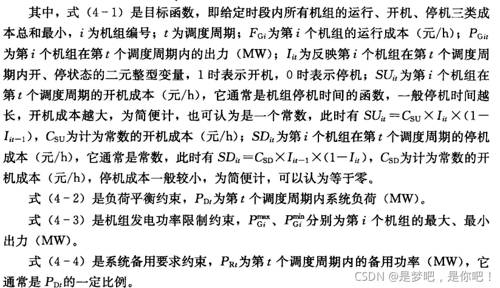
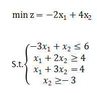
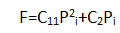
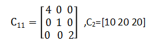
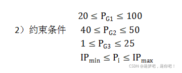
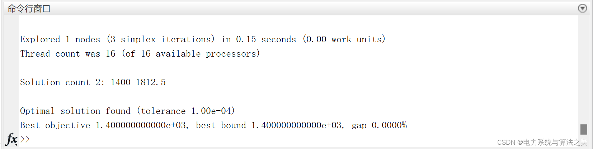
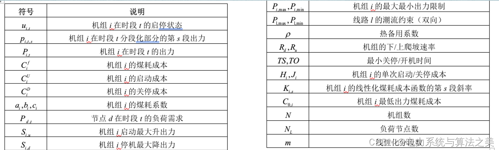
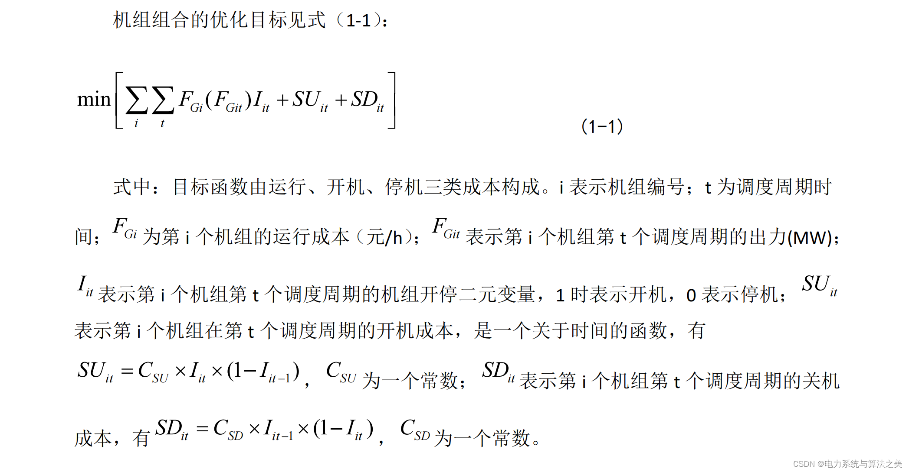
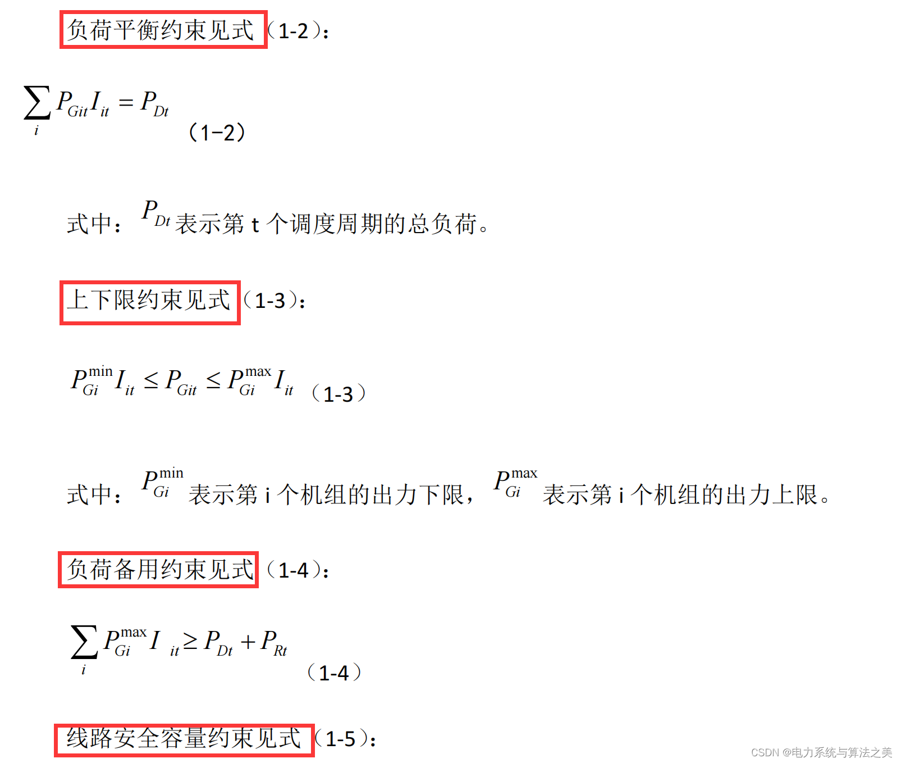
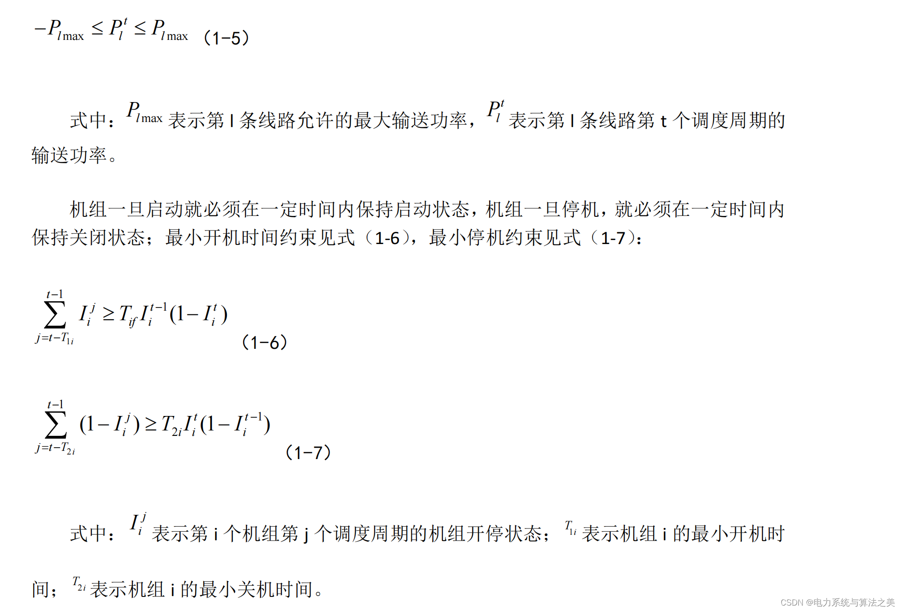
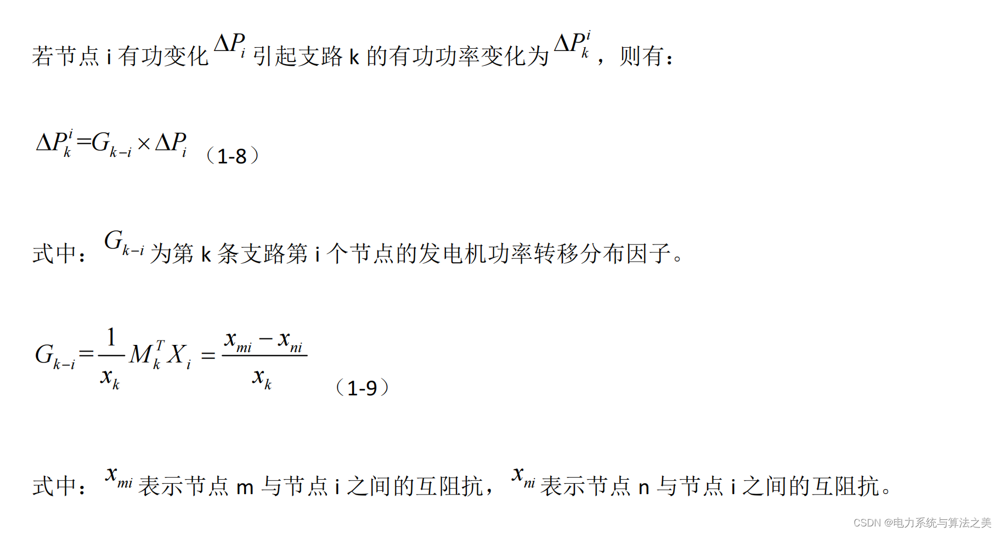
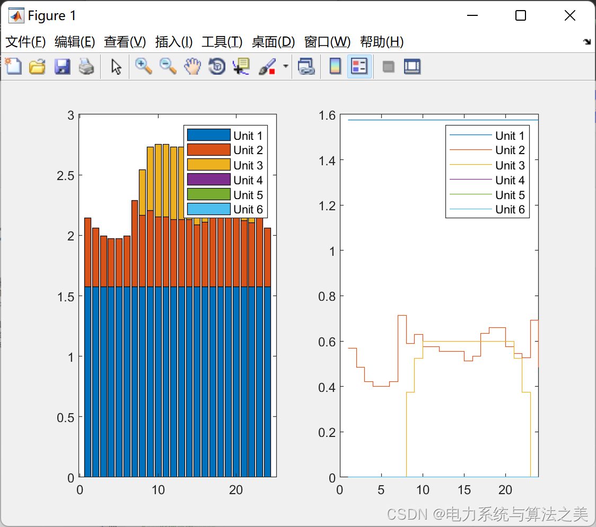

<!-- PAYMENT_BLOCK -->

## Get this dataset

- Payment link (Stripe): [Buy now](https://buy.stripe.com/3cs8yP7sY87d0vu9AB)
- Payment QR code: 

<!-- /PAYMENT_BLOCK -->
